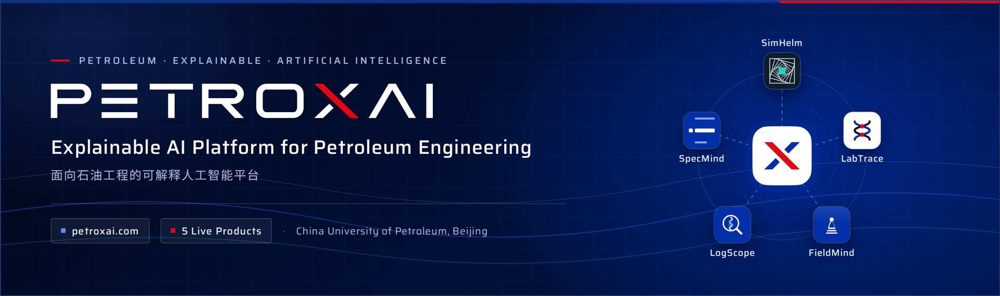

  <a href="https://petroxai.com">
    <picture>
      <source media="(prefers-color-scheme: dark)" srcset="https://raw.githubusercontent.com/PetroXAI/.github/main/profile/assets/banner-dark.png">
      <source media="(prefers-color-scheme: light)" srcset="https://raw.githubusercontent.com/PetroXAI/.github/main/profile/assets/banner-light.png">
      
    </picture>
  </a>

  
  
  
  

---

## About PetroXAI · 关于我们

**PetroXAI** (**Petro**leum · e**X**plainable · **A**rtificial **I**ntelligence) is an explainable artificial intelligence platform for petroleum and energy engineering.

We combine engineering physics and verifiable domain criteria with AI agents and generative models across five core areas: engineering simulation, research project management, oilfield production operations, well-logging quality control, and engineering standards retrieval. All platform applications share a single unified account at **[petroxai.com](https://petroxai.com)**.

> 面向石油工程的可解释人工智能平台：将经典物理与工程判据同可解释人工智能相结合，覆盖工程仿真、科研项目管理、油田生产管理、测井数据治理与工程标准检索。

---

## Platform Suite · 平台产品

<table>
  <thead>
    <tr>
      <th align="center" width="64">Icon</th>
      <th align="left" width="180">Product</th>
      <th align="left">Focus &amp; Capabilities</th>
      <th align="center" width="110">Access</th>
    </tr>
  </thead>
  <tbody>
    <tr>
      <td align="center" valign="middle">
        
      </td>
      <td valign="middle">
        <strong><a href="https://simhelm.petroxai.com">SimHelm 驭算</a></strong> 
        Engineering Simulation
      </td>
      <td valign="middle">
        <strong>Agent-driven engineering simulation platform.</strong> Natural-language workflow from geometry and multiphysics setup (solid mechanics, heat transfer, seepage, fluid flow, custom equations) to result analysis and online collaboration — agents execute (<em>Sim</em>), engineers stay in command (<em>Helm</em>). 
        智能体驱动的工程仿真平台：对话推进多物理场建模、求解分析与多人在线协作。
      </td>
      <td align="center" valign="middle">
        <a href="https://simhelm.petroxai.com">Launch →</a>
      </td>
    </tr>
    <tr>
      <td align="center" valign="middle">
        
      </td>
      <td valign="middle">
        <strong><a href="https://labtrace.petroxai.com">LabTrace</a></strong> 
        Project Management
      </td>
      <td valign="middle">
        <strong>AI-driven research project management platform.</strong> Automatically parses and archives project materials into a shared knowledge base, decomposes goals into role-assigned tasks, tracks actual progress, and adjusts schedules through natural-language dialogue. 
        AI 驱动的项目管理平台：资料解析归档、知识库沉淀、任务拆解与进度动态跟踪。
      </td>
      <td align="center" valign="middle">
        <a href="https://labtrace.petroxai.com">Launch →</a>
      </td>
    </tr>
    <tr>
      <td align="center" valign="middle">
        
      </td>
      <td valign="middle">
        <strong><a href="https://fieldmind.petroxai.com">FieldMind</a></strong> 
        Production Management
      </td>
      <td valign="middle">
        <strong>AI-assisted oilfield production management platform.</strong> Unifies field production databases and knowledge bases, supports performance tracking and anomaly alerts, and delivers traceable tool-assisted analysis grounded in real production data. 
        AI 辅助的油田生产管理平台：生产数据治理、动态监测预警与有据可查的智能问答分析。
      </td>
      <td align="center" valign="middle">
        <a href="https://fieldmind.petroxai.com">Launch →</a>
      </td>
    </tr>
    <tr>
      <td align="center" valign="middle">
        
      </td>
      <td valign="middle">
        <strong><a href="https://logscope.petroxai.com">LogScope</a></strong> 
        Well-Logging AI
      </td>
      <td valign="middle">
        <strong>Diffusion-model platform for well-log denoising and completion.</strong> Automatically detects missing and anomalous log intervals, performs probabilistic reconstruction via pretrained diffusion models, and supports manual interval selection for targeted repair. 
        扩散模型驱动的测井数据降噪与补全平台：异常识别、概率补全与自定义区间修复。
      </td>
      <td align="center" valign="middle">
        <a href="https://logscope.petroxai.com">Launch →</a>
      </td>
    </tr>
    <tr>
      <td align="center" valign="middle">
        
      </td>
      <td valign="middle">
        <strong><a href="https://specmind.petroxai.com">SpecMind</a></strong> 
        Engineering Standards
      </td>
      <td valign="middle">
        <strong>AI-driven engineering standards retrieval and Q&amp;A platform.</strong> Organizes engineering design standards into a structured knowledge base with clause-level answers linked directly back to source pages for verification. 
        AI 驱动的工程标准检索与问答平台：按设计问题精准定位标准条文与原文依据。
      </td>
      <td align="center" valign="middle">
        <a href="https://specmind.petroxai.com">Launch →</a>
      </td>
    </tr>
  </tbody>
</table>

---

## Open Source & Research · 开源与研究

We share open research resources, reference implementations, and engineering studies in Explainable AI and petroleum engineering on GitHub:

| Repository | Description |
| :--- | :--- |
| **[PetroXAI/XAI-theory-application](https://github.com/PetroXAI/XAI-theory-application)** | Theory, methods, and engineering applications of Explainable Artificial Intelligence · 可解释人工智能理论与应用 |
| **[PetroXAI/.github](https://github.com/PetroXAI/.github)** | Organization profile, visual identity assets, and community entry point · 组织主页与公共配置 |

Follow **[github.com/PetroXAI](https://github.com/PetroXAI)** to stay updated as additional open-source libraries, datasets, and benchmarks are released.

---

## Get Involved & Contact · 联系与合作

We welcome academic collaboration, industry trials, and open-source contributions.

- **Official Platform**: [https://petroxai.com](https://petroxai.com)
- **Unified Account Portal**: [https://account.petroxai.com](https://account.petroxai.com)
- **Email**: [hmeng@cup.edu.cn](mailto:hmeng@cup.edu.cn)
- **WeChat**: `petroxai`

 

  <a href="https://petroxai.com">
    <picture>
      <source media="(prefers-color-scheme: dark)" srcset="https://raw.githubusercontent.com/PetroXAI/.github/main/profile/assets/affiliation-dark.png">
      <source media="(prefers-color-scheme: light)" srcset="https://raw.githubusercontent.com/PetroXAI/.github/main/profile/assets/affiliation-light.png">
      
    </picture>
  </a>

